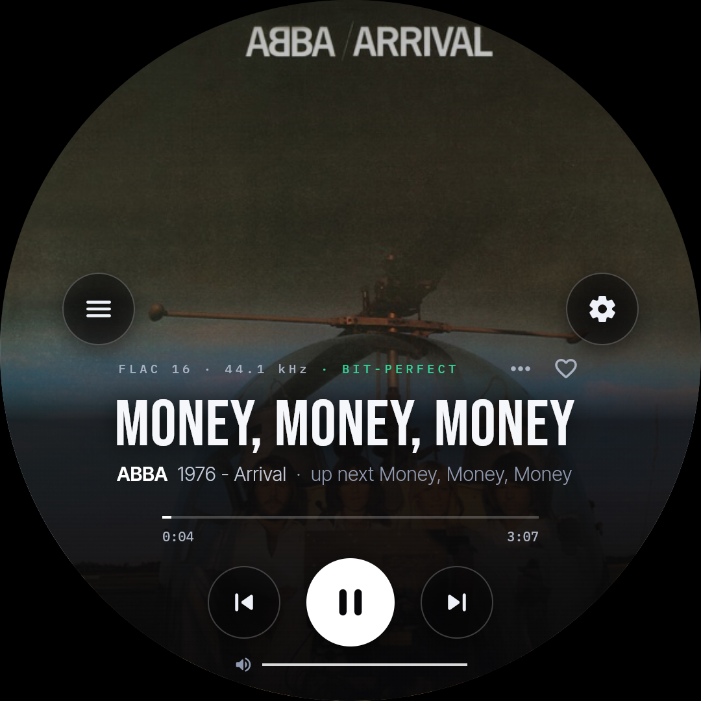
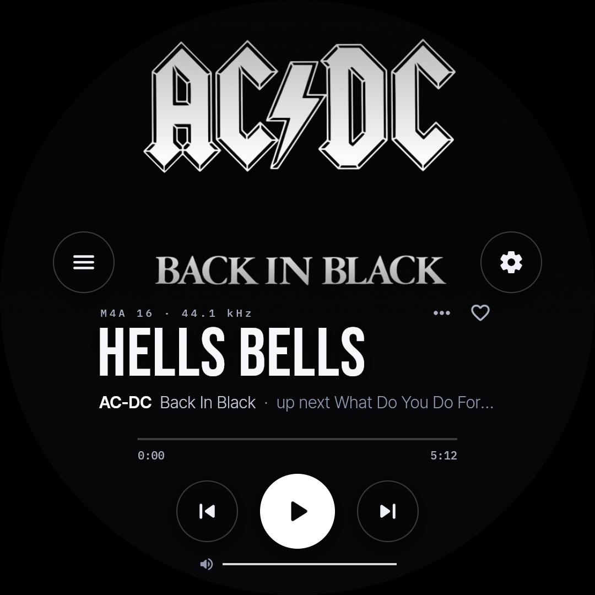
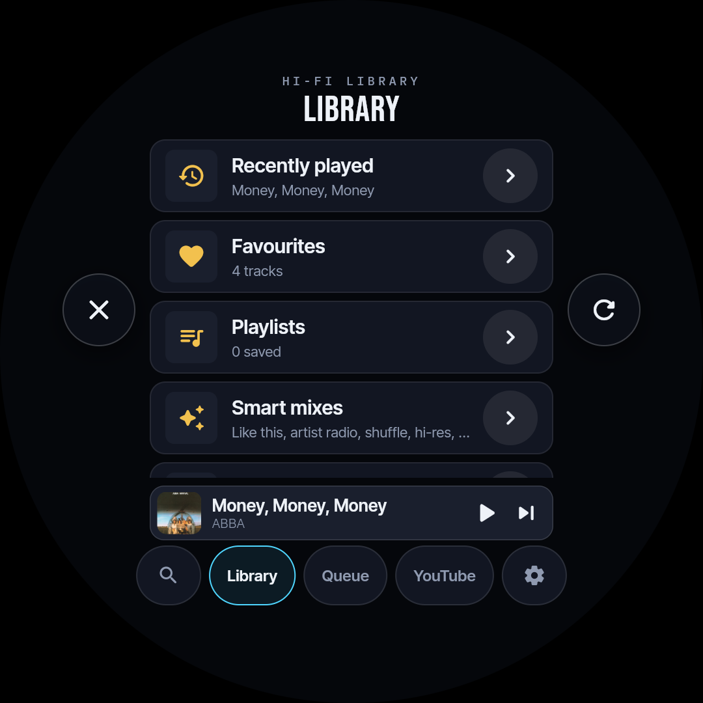
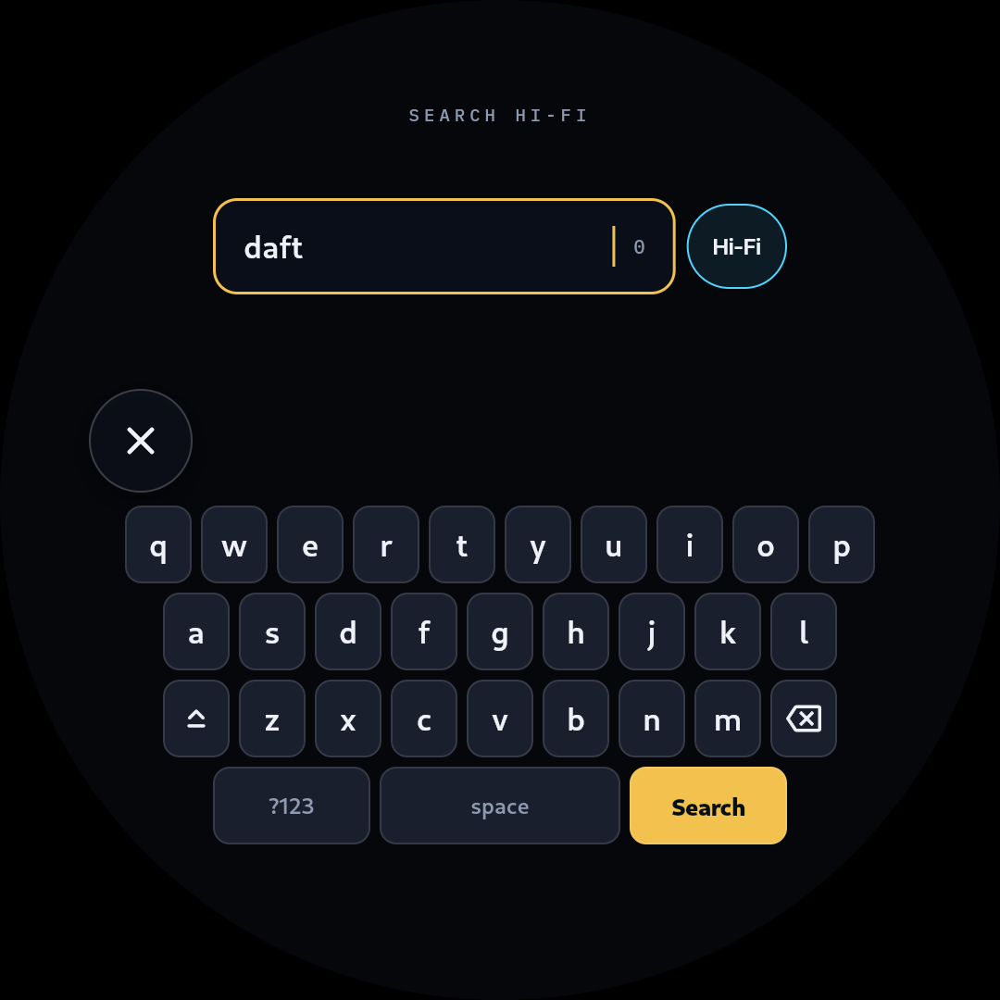
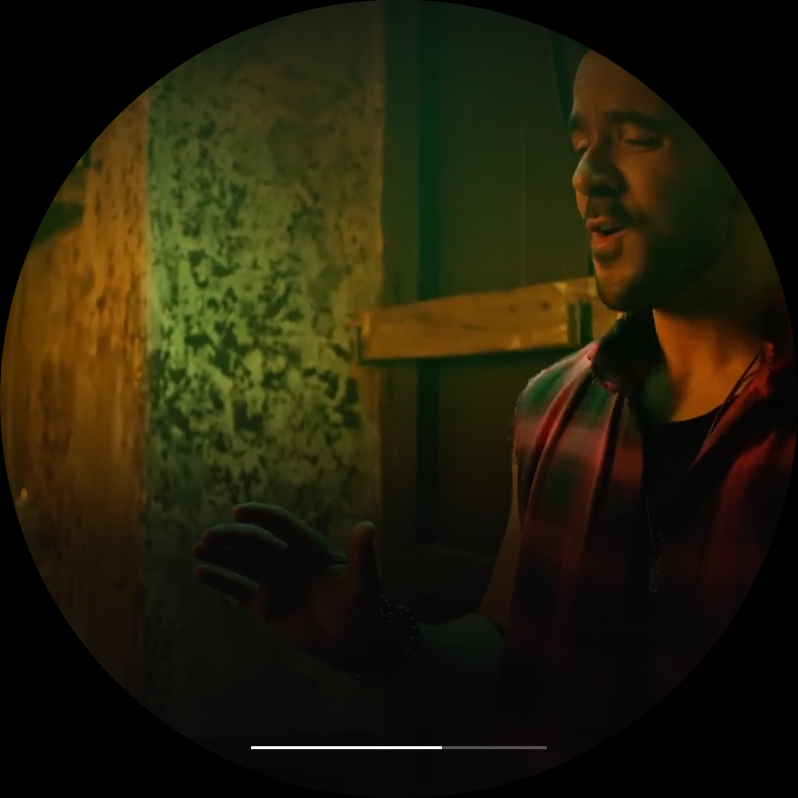
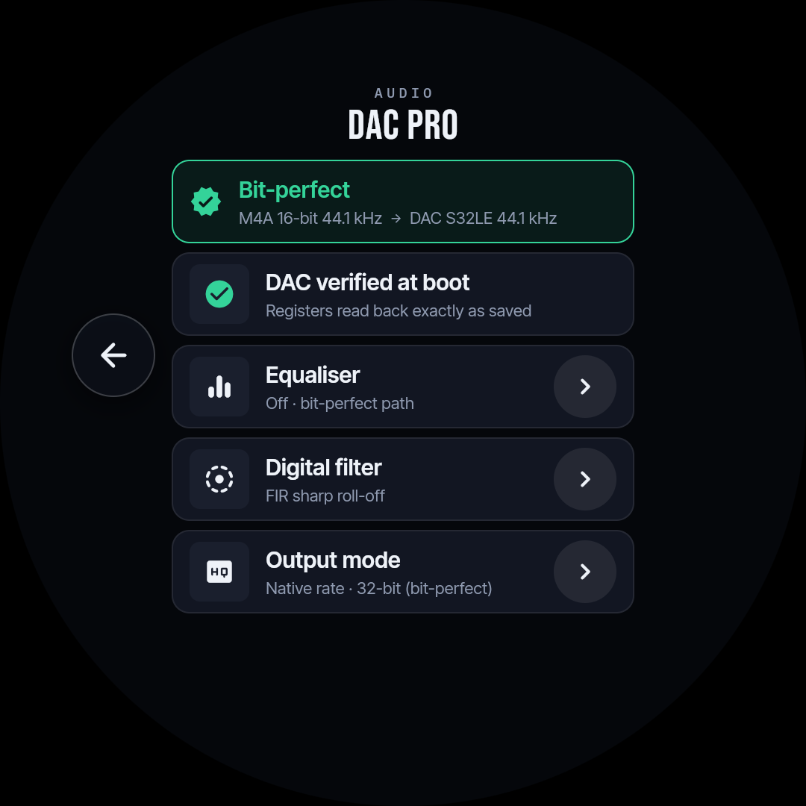

# RoundPlayer

<p align="center">
  
  
</p>

<p align="center">
  <strong>Audiophile Media Player with a 1080×1080 Circular Touch HUD, Bit-Perfect DAC Pro Output, Zero-Download YouTube EDL Streaming, and Mobile Web Remote.</strong>
</p>

<p align="center">
  <a href="#hardware-requirements"></a>
  <a href="#circular-touch-hud"></a>
  <a href="#bit-perfect-audiophile-audio"></a>
  <a href="#zero-download-youtube-streaming"></a>
  <a href="LICENSE"></a>
</p>

---

## Overview

**RoundPlayer** is an open-source, standalone audiophile media hub engineered specifically for circular touchscreens and high-resolution digital audio converters.

Built from the ground up to combine dedicated hi-fi hardware with modern streaming convenience, RoundPlayer runs an edge-to-edge Flutter-based circular user interface (Wayland/labwc) on a 5" 1080×1080 round display, powered by a Raspberry Pi 4 paired with a Texas Instruments PCM5242 DAC (Raspberry Pi DAC Pro).

Whether streaming uncompressed FLAC/DSD files from a cloud library, casting 1080p music videos from YouTube with zero download delay, receiving Apple AirPlay or Spotify Connect streams, or controlling playback through a responsive phone web remote, RoundPlayer provides bit-perfect sound with ultra-low latency.

---

## Screenshots Gallery

<p align="center">
  
  
  
</p>

<p align="center">
  
  
  
</p>

---

## Key Highlights

### ⭕ 1080×1080 Circular Touch HUD
- **Custom Flutter Engine**: A bespoke "Gallery × Editorial" typographic design language utilizing Bebas Neue, Inter Tight, and IBM Plex Mono.
- **Radial Geometry**: Built specifically for round screens; all touch targets, controls, and dials are confined within a safe 430 px radius ($r = 540\text{ px}$ canvas) with edge-distance touch expansion for effortless fingertip navigation.
- **Gallery Art Presentation**: Dynamic full-bleed album art presentation with intelligent background contrast shading, animated progress rings, and real-time live playback telemetry.
- **Editorial Clock & Weather Screensaver**: Automatic idle transition into an editorial chronometer display featuring live local weather, ambient temperature, and blurred album art background.

### 🎵 Bit-Perfect Audiophile Pipeline
- **Dedicated TI PCM5242 DAC**: Runs the native Linux `pcm512x` driver with ALSA/PipeWire configured for pure S32LE output with native rate tracking ($44.1\text{ kHz}$ to $192\text{ kHz}$) and sample-rate-matched clock switching.
- **Hardware Master Volume**: Volume attenuation is performed entirely in the DAC's analog/DSP hardware stage; PipeWire soft-mixer and `mpv` internal volume remain pinned at 0 dB (unity) for maximum signal-to-noise ratio.
- **Audiophile DSP & Filter Modes**: Switchable digital FIR / ringless interpolation filters, optional PipeWire stereo parametric EQ (7-band graphic/shelving), and custom crossfeed matrix for headphone listening.
- **Automatic Sound Check**: Hardware register verification loop on startup (`dacpro-ctl verify`) that confirms PLL lock and volume register integrity.

### ⚡ Zero-Download YouTube Streaming
- **EDL Range-Request Architecture**: Rather than downloading gigabytes of video to local flash storage, YouTube casts and search results resolve via `yt-dlp` into merged `edl://` video + audio streams in ~2.5 seconds.
- **Instant Seeking**: Seek instantly through 1080p H.264 video streams using HTTP range requests with minimal disk wear and zero pre-caching delay.
- **YouTube Music Mode**: Audio-only Opus stream extraction for YouTube Music tracks, rendering high-resolution thumbnail artwork in the lossless cover art layout.

### 📚 Cloud & Local Hi-Fi Library
- **Lossless Formats**: Native gapless playback for FLAC, ALAC, WAV, AIFF, DSD (DSF/DFF), and high-bitrate MP3/AAC.
- **Cloud Library Sync**: On-demand streaming and transparent LRU caching (up to 10 GB with high-watermark pruning) from Google Drive or local NAS storage.
- **Instant SQLite FTS5 Search**: Embedded SQLite database with full-text search (prefix matching, diacritics-insensitive) indexing thousands of tracks with sub-200ms query response times.
- **Smart Mixes & Playlists**: Algorithmic "Heavy Rotation", "Rediscover", "Decades", and "Artist Radio" playlists powered by local play history and skip-rate affinity tracking.

### 📱 Mobile Web Remote & Ecosystem Integration
- **Zero-Install Web Remote**: Fast PWA accessible on any phone or desktop browser (`http://roundplayer.local/` on port 80/8080) with real-time WebSocket state synchronization.
- **Apple AirPlay**: Lossless AirPlay streaming receiver via `shairport-sync` pipe with live metadata and album art extraction.
- **Spotify Connect**: Spotify Connect endpoint powered by `librespot`.
- **YouTube DIAL Receiver**: Cast directly from standard YouTube mobile apps via DIAL discovery.
- **Home Assistant MQTT**: Automatic MQTT discovery publishing now-playing sensors, playback controls, volume sliders, and sleep timers.

### 🌙 Display & Night Mode Engine
- **In-App Color Engine**: Custom software-rendered display engine providing brightness, contrast, and color warmth control ($3200\text{ K}$ to $6500\text{ K}$) for HDMI panels lacking hardware DDC/CI or GPU gamma LUT support.
- **Automated Night Schedule**: Smooth sunset-to-sunrise dimming and blue-light reduction.

---

## System Architecture

```
 ┌────────────────────────────────────────────────────────────────────────┐
 │                     Control & Streaming Inputs                         │
 │                                                                        │
 │  Phone Browser ──► Mobile Web Remote (:8080 / :80)                     │
 │  YouTube App   ──► yt-cast-receiver (DIAL :8008) ──┐                   │
 │  Apple AirPlay ──► shairport-sync (user unit)  ────┼──► [HTTP API]     │
 │  Spotify App   ──► librespot (user unit)       ────┤      │            │
 │  HomeAssistant ◄──► MQTT Bridge (HA Discovery) ────┘      │            │
 └───────────────────────────────────────────────────────────┼────────────┘
                                                             ▼
 ┌────────────────────────────────────────────────────────────────────────┐
 │            RoundPlayer Daemon (playback_manager.py :8000)              │
 │                                                                        │
 │  • Numbered Command Sequencer (seq/ack intent authority)               │
 │  • SQLite FTS5 Library Index & Google Drive Cache Manager              │
 │  • Zero-Download yt-dlp EDL URL Resolver                               │
 │  • DAC Hardware Volume & PipeWire Parametric Filter Engine             │
 │  • Display Calibration Engine & Solar Night Scheduler                  │
 │  • 60 Hz Binary/JSON Telemetry Server (/tmp/roundplayer_telemetry.sock)│
 └───────────────┬──────────────────────────────────┬─────────────────────┘
                 │ unix socket telemetry            │ numbered commands
                 ▼                                  ▼
 ┌────────────────────────────────────────────────────────────────────────┐
 │             Round HUD Kiosk (round_hud_app - Flutter arm64)            │
 │                                                                        │
 │  • 1080×1080 Wayland / labwc Kiosk Surface                             │
 │  • media_kit (libmpv) Audio/Video Hardware Decoders                    │
 │  • Radial Touch Hit-Testing & Optimistic Gesture Feedback              │
 └───────────────────────────────┬────────────────────────────────────────┘
                                 │ S32LE native audio
                                 ▼
 ┌────────────────────────────────────────────────────────────────────────┐
 │                    Hardware Audio Output Subsystem                     │
 │                                                                        │
 │  PipeWire (resample q14) ──► ALSA (pcm512x) ──► TI PCM5242 DAC Pro    │
 └────────────────────────────────────────────────────────────────────────┘
```

---

## Hardware Bill of Materials

| Component | Recommendation | Function / Notes |
|---|---|---|
| **SBC** | Raspberry Pi 4 Model B (4 GB) | Runs 64-bit OS, daemon, and Wayland kiosk. |
| **DAC HAT** | Raspberry Pi DAC Pro (or IQaudio DAC Pro) | Texas Instruments PCM5242 stereo DAC with hardware volume and balanced outputs. |
| **Display** | Waveshare 5" 1080×1080 Round HDMI LCD (sku 24369) | High-DPI IPS circular display with capacitive USB touch (panel ID: KTC WS050R). |
| **Storage** | 32 GB+ High-Endurance MicroSD or USB 3.0 SSD | System OS, SQLite database, and LRU audio cache. |
| **Power** | 5V 3.5A USB-C Power Supply | Clean power rail essential for low DAC noise floor. |

---

## Repository Structure

```
RoundPlayer/
├── source/roundplayer/             # Core application source
│   ├── playback_manager.py         # Main FastAPI daemon & playback coordinator
│   ├── hifi_manager.py             # FLAC/DSD library manager & cache pruner
│   ├── library_db.py               # SQLite FTS5 music catalog and play log
│   ├── yt_stream.py                # Zero-download yt-dlp EDL streaming resolver
│   ├── web_remote.py               # Mobile web remote server & WebSocket relay
│   ├── network_manager.py          # NetworkManager Wi-Fi control & setup AP
│   ├── dacpro-ctl                  # DAC hardware register & ALSA control utility
│   ├── display-ctl                 # Display brightness/warmth/night scheduler
│   ├── round_hud_app/              # 1080x1080 Flutter Circular UI application
│   │   └── lib/
│   │       ├── main.dart           # App entry point, telemetry client, mpv bridge
│   │       └── ui_v2/              # Modular UI components (Player, Library, Shell)
│   ├── services/                   # Systemd service unit definitions
│   └── install_pi.sh               # Automated device installer
├── prebuilt/                       # Pre-compiled linux-arm64 Flutter HUD bundle
├── system-snapshot/                # Live device configuration reference (/etc, boot)
├── docs/                           # Technical documentation
│   ├── api-reference.md            # Detailed REST API reference (114 endpoints)
│   ├── porting-notes.md            # In-depth engineering log & architecture decisions
│   ├── roadmap.md                  # Feature roadmap & milestones
│   └── backlog.md                  # Future feature backlog
├── design/                         # HTML UI mockups and design studies
└── screenshots/                    # High-resolution screenshots from live hardware
```

---

## Quick Start & Installation

### 1. Requirements
- Raspberry Pi OS (Debian 13 Trixie, 64-bit desktop image)
- Python 3.11+
- Node.js 20+ (for YouTube cast receiver)
- Flutter stable (arm64 Linux embedder)

### 2. Device Installation
Clone the repository to your Raspberry Pi and run the automated setup script:

```bash
git clone https://github.com/jadberro/RoundPlayer.git
cd RoundPlayer/source/roundplayer

# Run full setup (configures boot overlays, PipeWire, systemd services, and builds UI)
sudo ./install_pi.sh
```

The installer automatically:
1. Configures `/boot/firmware/config.txt` for the DAC Pro overlay (`dtoverlay=rpi-dacpro`) and disables on-board audio.
2. Applies PipeWire low-latency bit-perfect rules and WirePlumber DAC profiles.
3. Sets up systemd units for the daemon, web remote, cast receiver, AirPlay, and Spotify Connect.
4. Builds and installs the 1080×1080 Flutter kiosk into the `labwc` Wayland session.

### 3. Remote Configuration (Optional)
To point the player at a public Google Drive music collection, set the environment variable:

```bash
export ROUNDPLAYER_GDRIVE_FOLDER_ID="YOUR_PUBLIC_FOLDER_ID"
```

### 4. Running Tests Locally (No Pi Required)
You can verify the backend daemon and playback flow on any macOS or Linux machine:

```bash
cd source/roundplayer
python3 -I tests/test_hifi_flow.py --setup
HIFI_FAKE_DRIVE=/tmp/fake_drive ROUNDPLAYER_NO_NET_WATCHDOG=1 python3 playback_manager.py &
python3 -I tests/test_flows.py
```

---

## Web Remote Access

Once connected to your local network, access the web remote from any smartphone or computer:

- **Local URL:** `http://roundplayer.local/` (or `http://<device-ip>/`)
- Features:
  - Touch-optimized transport controls and live scrub bar
  - Full catalog navigation and instant search
  - 7-band parametric equalizer & crossfeed selector
  - Real-time display temperature and brightness tuning
  - Alarm clock and sleep timer configuration

---

## Contributing & Development

Contributions, feature requests, and bug reports are welcome! Please feel free to open an issue or submit a pull request.

For details on the playback sequencing protocol, PipeWire audio routing, and UI widget hierarchy, consult [`docs/porting-notes.md`](docs/porting-notes.md) and [`docs/api-reference.md`](docs/api-reference.md).

---

## License

This project is licensed under the [MIT License](LICENSE).
